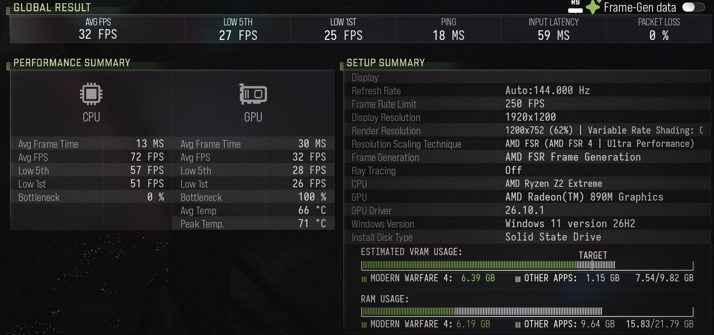

# Benchmark methodology and evidence

Public images are generated from docs/benchmark-summary.json by
`tools/Render-Benchmarks.ps1`. They contain no Steam account IDs or personal paths.
Private raw reports remain on the test device. The figures are not invented or
extrapolated to other devices. No raw screenshot with a player profile is published.

## COD source reports

- cod26_Benchmark_29663266_20261104_233501.csv: output1920x1200,
  render1200x752; base33, generated67 FPS; base1%25, generated1%50 FPS.
- cod26_Benchmark_29663266_20261104_234733.csv: output1280x800,
  render800x496; base55, generated109 FPS; base1%43, generated1%50 FPS.

Both: game13.2.29663266, mapmp_rex_lotus, driver26.10.1, ray tracing off.
Both runs use native FSR 4 in **Ultra Performance** mode with AMD frame generation.
The 800p run followed a display-resolution change in the Legion Go settings.

The old Lenovo-driver COD screenshot showed68 FPS average but omitted comparable
settings/counter state. It is not a valid driver-only A/B baseline. The new-driver
export ending232051 showed51 base/102 generated FPS and an upscaling labelNone;
keep it separate from the explicit FSR run.

## Interpretation

Changing output resolution also changed internal pixel count. This explains why
these are configuration comparisons, not an isolated estimate of FSR inference
cost. Generated frames increase displayed FPS without making it equivalent to a
higher base rendering rate. Input latency numbers are the game's exported metrics,
not independently measured end-to-end latency. Temperature fields equal to zero
are unavailable data, not an actual GPU temperature.

Future comparisons should fix output/internal resolution, graphics settings,
frame-generation state, TDP, power mode, charging state, and warm-up. Record at
least several runs if claiming a repeatable performance delta. Capture settings
screens when the export label is unreliable.

## Captured integration evidence

Cropped from a separate earlier run: native AMD FSR 4 and driver26.10.1 are visible.
This screenshot's32 base FPS is not substituted for the later33/55-FPS exports.
Player-profile and account-ID areas are excluded from the public crop.

